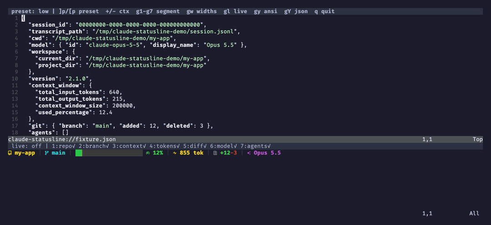
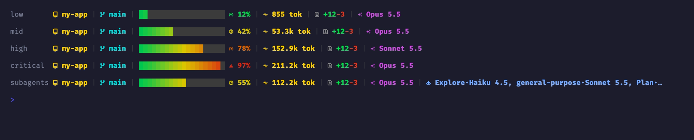
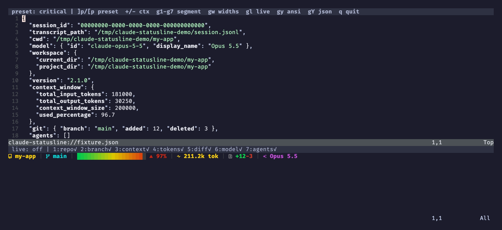
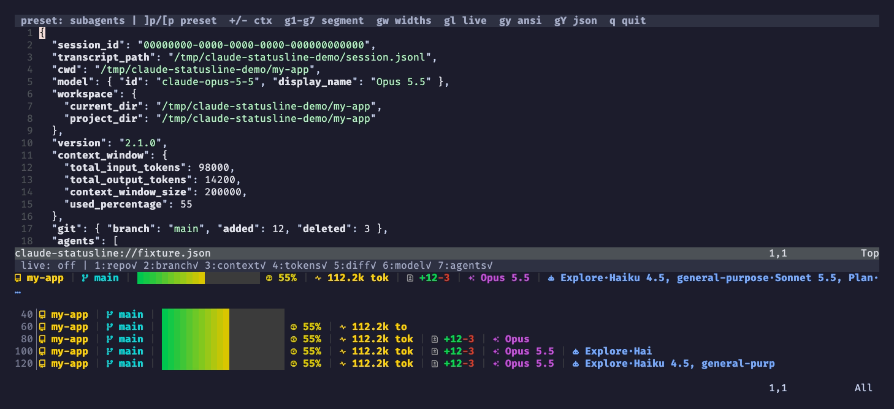

<div align="center">

# 󰚩 claude-statusline.nvim

**A Claude Code status line written in Lua, plus a Neovim playground for tuning it.**

Shows the repo, branch, a gradient context bar, token count, uncommitted diff, model, and running
subagents. Claude Code runs it with `nvim -l`, with no shell pipeline and no `jq`. The playground lets you
edit the session JSON and see the line re-render as you type.




</div>

## Why

Claude Code pipes a JSON blob into a status line command. The usual bash/`jq` script calls `jq` about ten times
per refresh and is hard to test. Tuning a colour or a threshold also means waiting for Claude Code to redraw.
This plugin changes that in three ways:

- A **pure renderer** (`render(ctx, opts) -> string`) that you can unit test, reorder, and trim.
- A **CLI entry point** that is about 2x faster than the bash version (see [Notes](#notes)).
- A **playground** with presets, a context slider, segment toggles, and a width check, so you can see every state
  of the line without waiting for a real session to reach it.



## Quick start

**1. Add the plugin** (lazy.nvim / LazyVim):

```lua
-- lua/plugins/claude-statusline.lua
return {
  "crafts69guy/claude-statusline.nvim",
  main = "claude_statusline",
  cmd = "ClaudeStatusline",
  opts = {
    -- optional: reorder or drop segments (default shown)
    -- segments = { "repo", "branch", "context", "tokens", "diff", "model", "agents" },
  },
  keys = {
    { "<leader>aP", "<cmd>ClaudeStatusline playground<cr>", desc = "Claude Statusline Playground" },
  },
}
```

**2. Point Claude Code at it** in `~/.claude/settings.json`:

```json
{
  "statusLine": {
    "type": "command",
    "command": "nvim -l ~/.local/share/nvim/lazy/claude-statusline.nvim/bin/statusline.lua"
  }
}
```

`bin/statusline.lua` sets `package.path` from its own location. It runs without your Neovim config and without
lazy.nvim, so any checkout path works. Use a terminal with truecolor and a [Nerd Font](https://www.nerdfonts.com).

**3. Open the playground** with `:ClaudeStatusline playground` (or `<leader>aP`).

## Segments

Segments render in this order and are joined with a dim grey `|`. A segment with nothing to show is skipped.

| #   | Segment   | Source                                                                    | Look                                                                     |
| --- | --------- | ------------------------------------------------------------------------- | ------------------------------------------------------------------------ |
| 1   | `repo`    | `workspace.repo.name`, else the basename of `workspace.current_dir`       | bold yellow, ``                                                         |
| 2   | `branch`  | `git rev-parse --abbrev-ref HEAD` in `current_dir`                        | bold cyan, ``                                                           |
| 3   | `context` | `context_window.used_percentage`, rounded half-to-even                    | 20 blocks fading green → yellow (block 10) → red, rest dark grey         |
| 4   | `tokens`  | `total_input_tokens + total_output_tokens`                                | bold yellow, ` 53.3k tok` (`999 tok` below 1k)                                           |
| 5   | `diff`    | `git diff --shortstat HEAD` (uncommitted lines)                           | grey `` with green `+N` and red `-M`; hidden when both are 0            |
| 6   | `model`   | `model.display_name` (default `Claude`)                                   | bold magenta, `󰙴`                                                        |
| 7   | `agents`  | running subagents of this session                                         | bold blue, `󰚩 Explore·Sonnet 5.5, Plan·…`                                |

The icon and colour of the context percentage change with usage:

| Used       | Icon | Colour |
| ---------- | ---- | ------ |
| < 20%      | 󰾆    | green  |
| 20 – 69%   | 󰊚    | yellow |
| 70 – 89%   | 󰓅    | orange |
| ≥ 90%      | 󰀦    | red    |

How subagents are detected:
- It scans `<transcript_path without .jsonl>/subagents/agent-*.jsonl` for files modified in the last 120 minutes.
- An agent is finished when its last line is an `assistant` turn with `stop_reason: "end_turn"`. Finished agents
  are hidden.
- The type comes from the matching `.meta.json` (`agentType`). The model is the last `"model":"claude-…"` in the
  transcript, so `claude-sonnet-5-5` becomes `Sonnet 5.5`.
- A killed agent never writes `end_turn`, so it stays visible until its file is 2 hours old.

## Playground



`:ClaudeStatusline playground` opens a new tab. The top window is an editable JSON fixture (`ft=json`). Below it
is a terminal buffer that renders the real ANSI output and updates on every edit, including in insert mode.
If the JSON is invalid, the preview shows the decode error.

| Key         | Action                                                                              |
| ----------- | ----------------------------------------------------------------------------------- |
| `]p` / `[p` | next / previous preset                                                              |
| `+` / `-`   | `context_window.used_percentage` ±5 (clamped to 0–100)                              |
| `g1` … `g7` | toggle segment N (the preview winbar shows `N:name✓/✗`)                             |
| `gw`        | also render the line cut to 40 / 60 / 80 / 100 / 120 cells                          |
| `gl`        | live collect: replace the mock `git` / `agents` with real data                      |
| `gy` / `gY` | yank the raw ANSI line / the current JSON (into `"` and `+`)                        |
| `q`         | close the playground                                                                |

**Presets** live in `fixtures/*.json`: `empty`, `low`, `mid`, `high`, `critical`, `subagents`, `no-git`,
`long-names`. The tests use the same files. Each one is a realistic Claude Code payload plus two mock keys, `git`
and `agents`, so the playground works without a repo or a running session.

**Live collect** (`gl`) runs the same collection code as the CLI. It reads git from `workspace.current_dir` and
subagents from `transcript_path`. To preview your real repo and session, edit those two paths.

**Width check** (`gw`) shows where the line gets cut in a narrow terminal:



## Development

You need Neovim 0.10+, `stylua`, and `selene` (`brew install selene`). Coverage also needs `luarocks`.

| Target           | What it does                                                                                               |
| ---------------- | ---------------------------------------------------------------------------------------------------------- |
| `make test`      | `nvim -l tests/run.lua`: unit checks, a headless drive of every playground key, and byte parity with bash   |
| `make coverage`  | installs luacov into `./.rocks` (repo-local, LuaJIT/5.1) if missing, runs the tests under it, and fails below 98% (`MIN=` to override) |
| `make lint`      | `selene lua plugin bin tests` (`selene.toml` with the `vim.yml` std)                                        |
| `make fmt`       | `stylua .`                                                                                                 |
| `make fmt-check` | `stylua --check .`                                                                                         |
| `make check`     | runs `fmt-check`, then `lint`, then `coverage`                                                             |
| `make clean`     | removes `.rocks/` and the luacov output                                                                    |

```sh
cat fixtures/mid.json | nvim -l bin/statusline.lua   # one line, real git/agents collection
./assets/render.sh [statusline playground widths demo]   # re-record README media (needs vhs + ffmpeg)
```

`assets/render.sh` records with [VHS](https://github.com/charmbracelet/vhs) and composites the frames with
ffmpeg, the same setup as cocoindex.nvim. Neovim runs with a throwaway init that only adds this repo to
`'rtp'`, so the media doesn't depend on your config. It uses the FiraCode Nerd Font Mono font.

The parity test pipes every fixture into both `bin/statusline.lua` and `tests/statusline-command.sh`, a copy of
the original bash/jq script. It runs them against a temporary clean git repo and fake subagent transcripts, and
requires byte-identical output. To compare against another script, set `CLAUDE_STATUSLINE_BASH`.

## Notes

**Differences from the original bash script.** On the same input, the output is the same byte for byte, except
in these cases:

- **The diff segment works here.** The bash script runs `git diff --no-lock-index`, which isn't a valid flag:
  git exits with 129, so the `+N-M` segment never renders. This plugin runs `git --no-optional-locks diff
  --shortstat HEAD`.
- An agent with no `.meta.json` shows as `agent·…`. Bash shows an empty type (`·…`).
- A subagent model id that doesn't match `claude-<family>-<major>-<minor>` is shown capitalized as is. Bash
  shows the raw grep match (`"model":"claude-x"`).
- In a repo with no commits, no branch is shown. Bash may print `HEAD`.
- Only the top level of `subagents/` is scanned. Bash's `find` also looks in subfolders.

**Startup cost.** `nvim -l` skips your config and plugins. Averaged over 20 runs on an M-series Mac:

| Command                                  | Time    |
| ---------------------------------------- | ------- |
| `nvim -l /dev/null` (bare startup)       | ~12 ms  |
| `bin/statusline.lua`, no git repo         | ~19 ms  |
| `bin/statusline.lua`, real repo + agents  | ~38 ms  |
| original bash + jq, no git repo           | ~53 ms  |

The two git calls run in parallel through `vim.system`. Subagent transcripts are read whole, so a session with
many large agent transcripts costs a few extra milliseconds.

**Options only apply inside Neovim.** `setup({ segments = … })` changes the playground. The CLI never loads your
config, so Claude Code always gets the default order. To change the order there, edit `M.order` in
`render.lua` in your fork.

## License

MIT
